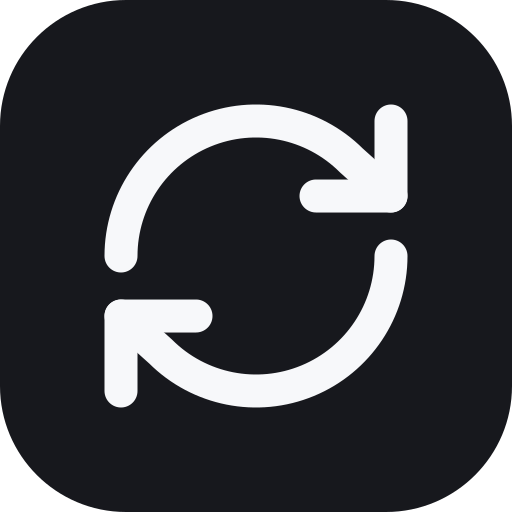
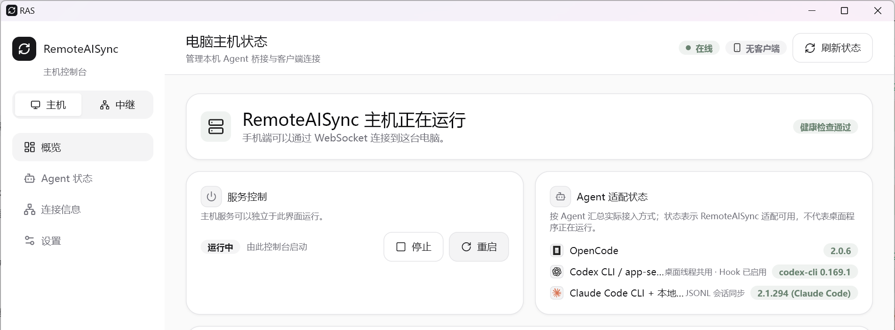
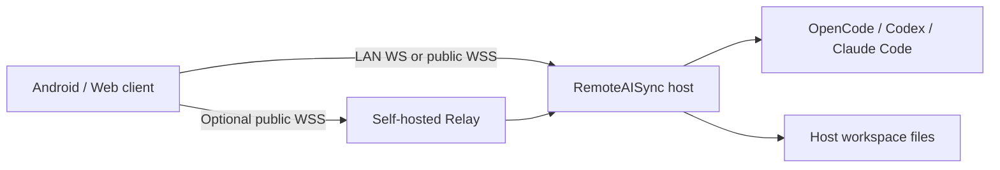

  
  <h1>RemoteAISync</h1>
  
<strong>Your AI coding agents, available from your phone and browser.</strong>

  
Keep agents and project files on your own host. Use the Android or Web client to review sessions, manage workspace files, and take over when needed.

  
  
  
  

**简体中文：** [README.md](README.md) · **Documentation:** [docs/README.md](docs/README.md)

## Product Preview

| Windows host | Phone client |
| --- | --- |
|  |  |

## One host, flexible connections

RemoteAISync consists of a client, an Agent host, and an optional self-hosted Relay. Agents run on your Windows or Linux host. Clients connect directly over a local network, through public WSS, or via a Relay you operate. The project does not provide model hosting or proxy model-provider accounts.

### Supported Agents

   <strong>OpenCode</strong>
  &nbsp;&nbsp;&nbsp;
   <strong>Codex</strong>
  &nbsp;&nbsp;&nbsp;
   <strong>Claude Code</strong>

Integration and available controls differ by Agent. For example, RemoteAISync cannot take over an active turn owned by the Codex desktop app. See the Agent notes in the [documentation index](docs/README.md).

## What you can do

- **Remote sessions:** Review and continue supported Agent sessions, create sessions, send messages, and inspect replies and tool activity. Available controls depend on the Agent and session type.
- **Workspace files:** Browse host directories, view and edit text files, upload attachments, download files, and delete selected files.
- **Trusted pairing:** Pair with a single-use invitation from the host. First-time connections require host approval; paired devices can be reviewed and revoked.
- **Flexible routes:** Connect directly over LAN, connect to a public host over WSS, or use a self-hosted Relay for both phone and host.
- **Host and Relay:** Manage the host through the Windows desktop UI, or run headless Host and Relay services on Ubuntu/Linux.

## Get started

| Goal | Guide |
| --- | --- |
| Try the client in a browser | [Open the RemoteAISync Web App](https://ras.xiaoshijourney.com/app/) |
| Start the client, host, and relay end to end | [Full startup guide](docs/全链路启动指南.md) |
| Choose direct or three-part deployment | [Two-part and three-part deployment guide](docs/两端与三端部署指南.md) |
| Deploy a Host or Relay on Ubuntu | [Ubuntu deployment manual (English)](deploy/ubuntu/README.md) |
| Find other project docs | [Documentation index](docs/README.md) |

## Security boundary

Use WSS for public connections; plain `ws://` is for trusted LAN or VPN networks only. **The current version does not provide end-to-end encryption (E2EE).** A TLS-terminating proxy and operators with access to a Relay host or proxy may be able to read application messages passing through them. Relay forwards connections; it does not run Agents. Pair only trusted devices and protect host, relay, and device credentials.

## Project links

- [Website](https://ras.xiaoshijourney.com/) · [Web App](https://ras.xiaoshijourney.com/app/) · [GitHub](https://github.com/xiaoshijourney/RemoteAISync)
- [Issues and suggestions](https://github.com/xiaoshijourney/RemoteAISync/issues)
- [MIT License](LICENSE)
