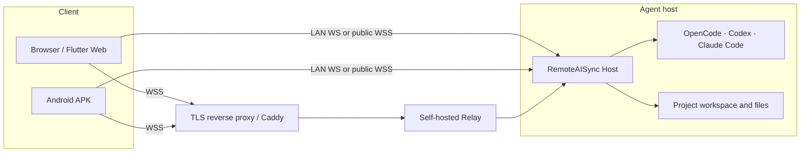
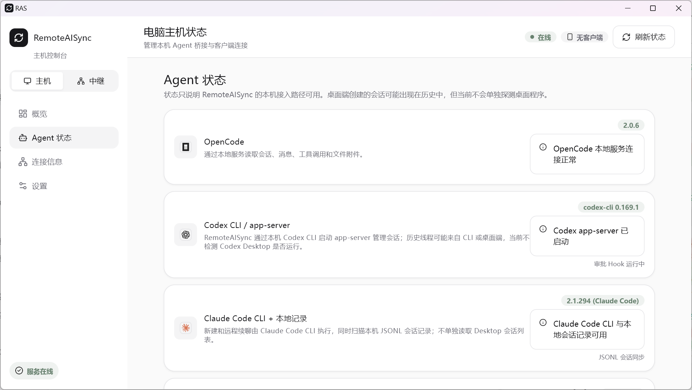
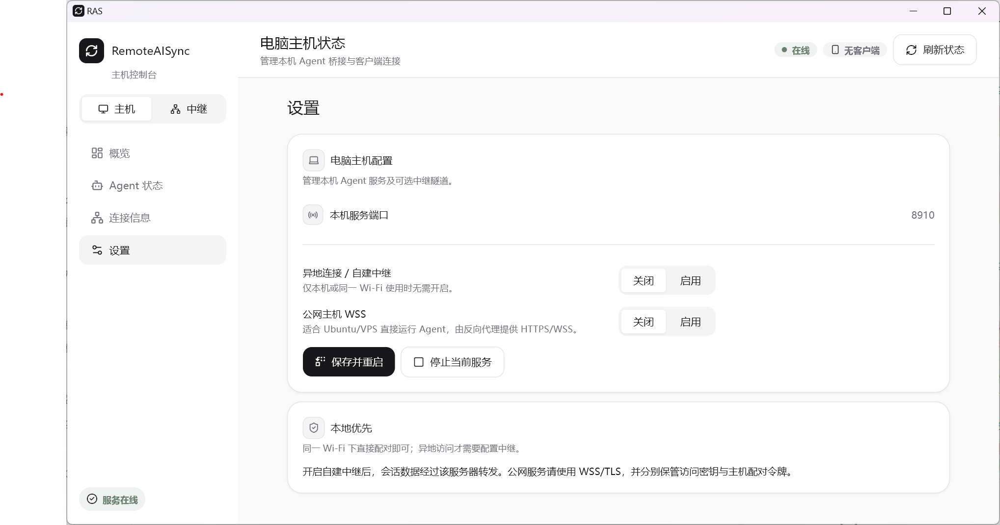
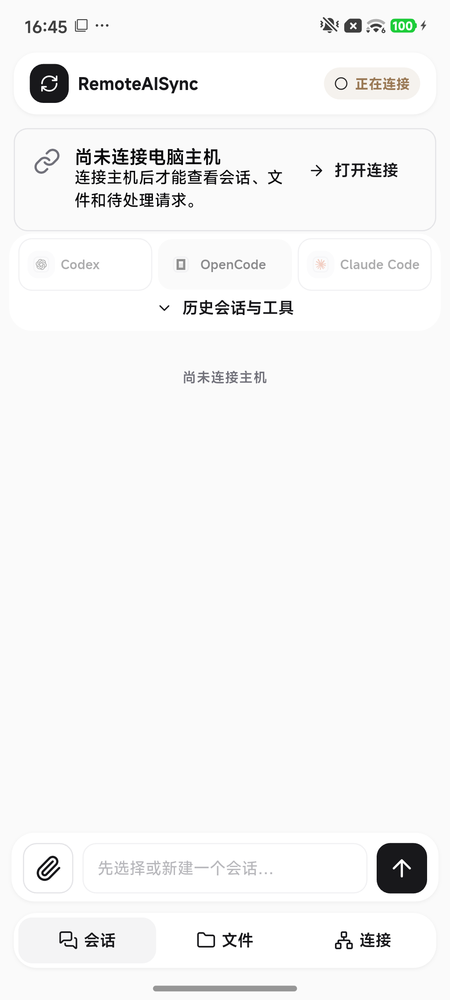
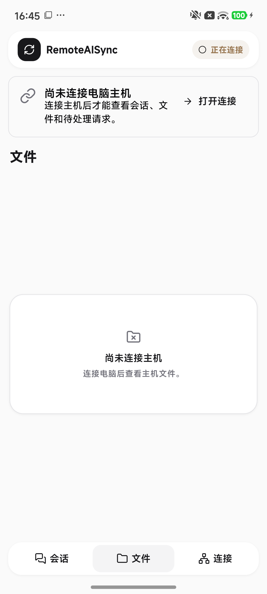

# RemoteAISync (RAS)

**Bring the AI coding agents running on your own computer or server to your phone and browser.**

RemoteAISync is a self-hosted remote client, Agent host, and WebSocket relay. Agents and project files stay on the host. A phone or browser connects directly over a LAN, or reaches the host through a relay you operate. The project does not provide a cloud service or proxy model-provider accounts.

[简体中文](README.md) · [End-to-end startup guide](docs/全链路启动指南.md) · [Ubuntu deployment manual](deploy/ubuntu/README.md) · [Wire protocol](docs/protocol.md) · [Report an issue](https://github.com/xiaoshijourney/RemoteAISync/issues)

## Product Overview

| Client | Agent host | Relay |
| --- | --- | --- |
| Flutter Web and Android APK | Windows desktop GUI; headless Ubuntu/Linux runtime | The same Dart runtime in Relay mode; Ubuntu deployments are managed with systemd and commonly use Caddy |



### Windows Host Console


### Agent Adapter Status



### Host Settings



### Phone Session and Files Views

These Android device screenshots show the session and files empty states while no host is connected. After connecting, the pages show the Agents, sessions, and workspace files exposed by the host.

| Session | Files |
| --- | --- |
|  |  |

## Features

- View and continue supported OpenCode, Codex, and Claude Code sessions from a phone or browser.
- Create sessions, send messages, inspect Agent replies and tool activity, and use supported stop, approval, question, and model controls according to the Agent and session type.
- Browse the host workspace, choose a working directory, inspect supported files, and upload attachments.
- Pair a device with a short-lived, single-use invitation. First-time pairing requires host approval; paired devices can reconnect and be revoked by the host.
- Keep LAN and relay routes in one connection profile. The client prefers a reachable LAN route and can use a relay or direct WSS route for remote access.
- Select Host or Relay role in the same Dart runtime. Relay routes client and host traffic using connection and room credentials; it does not run Agents.
- Inspect Agent, host service, client, and pairing status in the Windows GUI. Use systemd to manage headless Host or Relay processes on Ubuntu.

## Agent Support and Limits

| Agent | Integration | Limitations |
| --- | --- | --- |
| OpenCode | Local OpenCode Server API and events | The OpenCode service must be available on the host. Exact controls depend on the service and version. |
| Codex | Official app-server JSON-RPC | RemoteAISync-created sessions support live controls. Existing desktop sessions are mainly available for history and queued submissions; RemoteAISync cannot take over a desktop-owned active turn or its native pending question. |
| Claude Code | Local CLI and JSONL transcripts | Tasks started by RemoteAISync can be continued and stopped. Claude's native Remote Control and native approval handoff are not integrated. |

The UI exposes operations according to integration capabilities and session origin. Agent model access, authentication, versions, and local CLI/API availability depend on the host environment.

## Choose a Connection Route

| Scenario | Recommended route | Notes |
| --- | --- | --- |
| Phone and host on the same Wi-Fi or private VPN | Direct LAN: `ws://host-ip:8910/ws` | Simple and fast; use only on a trusted network. Allow the host port through the appropriate firewall. |
| A public Ubuntu/VPS runs the Agent itself | Direct host: `wss://host.example.com/ws` | No relay is required. Caddy/Nginx terminates TLS and proxies to the local Host process. |
| A Windows host at home is behind NAT and needs remote access | Phone and host connect through a self-hosted Relay | The host opens an outbound relay connection, so no inbound home-router port forward is needed. Use WSS on the public Internet. |
| Relay on a trusted private network | `ws://relay-ip:8920/relay` | Plain WS is for trusted LAN/VPN use only. Use WSS/TLS for public deployments. |

The public DNS examples use `host.example.com` and `relay.example.com`; replace them with full domain names you control. A domain makes it straightforward to obtain a publicly trusted TLS certificate, so phones do not need a custom CA installed. The Flutter Web client itself must also be hosted at an HTTPS site reachable from remote networks; `start_client.bat` starts a development server, not a production public website.

## Pairing and Credentials

1. The host creates a short-lived, single-use pairing invitation and presents a QR code or manual details.
2. The client scans or imports the invitation and attempts the configured host route.
3. The host operator approves the first connection. The client then saves its device identity for reconnects.
4. The host can inspect and revoke paired devices.
5. The relay administrator secret stays on the relay. A relay registration code is used only to register a host. The phone uses room-scoped client credentials and must never receive the relay administrator secret.

Credentials have separate roles and must not be interchanged: relay administrator secret, one-time host registration code, room host/client credentials, and phone device credentials. Do not commit QR payloads, tokens, `.env` files, private keys, or screenshots containing credentials.

## Security Model

- Use `wss://` on public networks. Plain `ws://` is for trusted LANs or VPNs only.
- WSS encrypts traffic between each endpoint and the TLS termination point. A reverse proxy can see the decrypted application traffic.
- **This release does not implement end-to-end encryption (E2EE).** A self-hosted Relay operator and anyone with access to the relay host or proxy may read application messages that pass through it. Relay does not run Agents, but it is not an opaque encrypted tunnel from the relay operator.
- Do not expose `/admin/*` publicly. Restrict Dart Host/Relay listener ports to loopback or private networks and publish only the required proxy paths.
- Agents run with the permissions of the host operating-system user. Pair only trusted devices, limit accessible project directories, and protect host and relay credentials.

## Quick Start: Windows Development

### Prerequisites

- Windows 10/11, Git, and Flutter (the repository Dart SDK constraint is `^3.12.2`).
- The Visual Studio **Desktop development with C++** workload is required for the Windows desktop app.
- Install and authenticate the Agent you intend to use on the host. The relay does not need Agents installed.

From the repository root in PowerShell:

```powershell
flutter pub get
flutter run -d windows -t lib/main_desktop.dart
```

Select **Host** mode in the window, check Agent status, start the host service, and create a phone pairing invitation. Do not start a second Host instance on port `8910` from another terminal.

### Start the Web Client

In a second terminal:

```powershell
flutter run -d web-server --web-hostname 0.0.0.0 --web-port 8911
```

- On the same computer: `http://localhost:8911`
- On a phone on the same Wi-Fi: `http://<computer-LAN-IPv4>:8911`
- Do not use `0.0.0.0` as the browser address. If Windows Firewall prompts, allow Flutter/Dart on Private networks only.

`start_host.bat`, `start_client.bat`, and `start_relay.bat` are convenience scripts for development. To build a portable Windows directory, run:

```powershell
./tooling/build_windows_release.ps1
```

The output is `build/windows/x64/runner/Release/`, containing the Flutter GUI and Dart Host/Relay runtime. This is a portable directory, not an installer; distribute the complete Release directory.

## Android APK

```powershell
flutter pub get
flutter build apk --release
```

APK output: `build/app/outputs/flutter-apk/app-release.apk`. Install on a USB-debugging Android device:

```powershell
adb install -r build/app/outputs/flutter-apk/app-release.apk
```

The Android APK is a client. Install and run the Agent on a separate Windows/Linux machine running Host mode. Configure Android signing before distributing a production APK.

## Ubuntu / Linux Deployment

The Linux runtime is one executable with roles selected using `--mode host` or `--mode relay`. Build on Linux for the target architecture; a Windows binary cannot run on Ubuntu. The server does not need the Dart SDK after installation.

### 1. Build

On Ubuntu or a Linux build machine with the same target architecture, clone the repository and run:

```bash
chmod +x deploy/ubuntu/build_linux.sh
deploy/ubuntu/build_linux.sh
```

The artifact is `build/remotaisync`. Install it as `/opt/remotaisync/remotaisync`. Start from the repository templates and see the [complete Ubuntu deployment manual](deploy/ubuntu/README.md).

### 2. Ubuntu as a Public Agent Host (No Relay)

Point DNS `host.example.com` to the server. Allow inbound TCP `80/443` (and your SSH administration port); do not expose `8910` directly. Install Caddy and use the repository [Caddyfile](deploy/ubuntu/Caddyfile), which proxies `host.example.com` paths `/ws` and `/health` to `127.0.0.1:8910`. Caddy can automatically obtain and renew the public TLS certificate.

Install the service and environment template:

```bash
sudo useradd --system --home /var/lib/remotaisync-host --shell /usr/sbin/nologin remotaisync-host
sudo install -d -o remotaisync-host -g remotaisync-host -m 0750 /var/lib/remotaisync-host/project
sudo install -d -o root -g remotaisync-host -m 0750 /etc/remotaisync-host
sudo install -m 0640 -o root -g remotaisync-host deploy/ubuntu/host.env.example /etc/remotaisync-host/host.env
sudo install -m 0644 deploy/ubuntu/remotaisync-host.service /etc/systemd/system/remotaisync-host.service
sudo install -m 0755 build/remotaisync /opt/remotaisync/remotaisync
```

Edit `/etc/remotaisync-host/host.env`. Set the project directory, `wss://host.example.com/ws`, a random pairing token of at least 32 characters, and the exact allowed Web client Origin. `REMOTEAI_HOST_ALLOWED_ORIGIN` is needed only for browser clients. Never put real secrets in the repository.

```bash
sudo systemctl daemon-reload
sudo systemctl enable --now remotaisync-host
sudo systemctl status remotaisync-host
sudo journalctl -u remotaisync-host -f
```

For a headless host, create an invitation and approve the device through the loopback management API on the server itself. See the [Ubuntu Host instructions](deploy/ubuntu/README.md#run-this-ubuntu-server-as-an-agent-host) for the exact commands and endpoints.

### 3. Ubuntu as a Public Relay

Point `relay.example.com` DNS to the server. Publish only TCP `80/443`; Relay listens internally at `127.0.0.1:8920`. Caddy proxies only `/relay`, `/register-host`, and `/health`, and blocks public `/admin/*`. Install and configure the environment template:

```bash
sudo useradd --system --home /var/lib/remotaisync-relay --shell /usr/sbin/nologin remotaisync
sudo install -d -o root -g root -m 0755 /opt/remotaisync
sudo install -d -o remotaisync -g remotaisync -m 0750 /var/lib/remotaisync-relay
sudo install -d -o root -g remotaisync -m 0750 /etc/remotaisync-relay
sudo install -m 0640 -o root -g remotaisync deploy/ubuntu/relay.env.example /etc/remotaisync-relay/relay.env
sudo install -m 0644 deploy/ubuntu/remotaisync-relay.service /etc/systemd/system/remotaisync-relay.service
sudo install -m 0755 build/remotaisync /opt/remotaisync/remotaisync
```

Set two independent random values in `/etc/remotaisync-relay/relay.env`: `REMOTEAI_RELAY_ADMIN_TOKEN` and `REMOTEAI_RELAY_HOST_SECRET`, each at least 32 characters. Protect this file and the room credential data under `/var/lib/remotaisync-relay`, then start the service:

```bash
sudo chown root:remotaisync /etc/remotaisync-relay/relay.env
sudo chmod 0640 /etc/remotaisync-relay/relay.env
sudo systemctl daemon-reload
sudo systemctl enable --now remotaisync-relay
sudo systemctl status remotaisync-relay
sudo systemctl reload caddy
curl --fail https://relay.example.com/health
```

Issue a one-time host registration code locally on the Relay server. The host operator uses it in the Windows/Ubuntu host setup. Never send this code to the phone client. See [issuing and revoking registration codes](deploy/ubuntu/README.md#issue-or-revoke-a-host-registration-code) for exact commands.

### 4. Routine Operations

```bash
sudo systemctl restart remotaisync-relay   # or remotaisync-host
sudo journalctl -u remotaisync-relay -n 100 --no-pager
curl --fail https://relay.example.com/health
```

Host and Relay can run on the same Ubuntu server with separate service accounts, configuration, data directories, and ports. Back up relay room state and credentials. When rotating secrets, assess whether registered hosts or paired devices need to register or pair again.

## Deploy the Web Client

Build the static web bundle:

```bash
flutter build web --release
```

Deploy `build/web/` to an HTTPS static site or web server. When the browser page uses HTTPS, public Host/Relay connections must use WSS as well. Allow the exact website Origin in Host configuration when deploying on a separate domain. Do not expose `flutter run -d web-server` as a production website.

## Ports and Troubleshooting

- `8910`: default Host WebSocket/HTTP service port.
- `8911`: example development Web client port on Windows.
- `8920`: default local Relay backend port; public deployments terminate TLS on port `443`.
- `http://0.0.0.0:8911` is not a browser address. Use localhost or the computer's actual LAN IPv4 address.
- `Address already in use`: another process owns the port. Stop the duplicate instance or check whether the GUI has already started Host.
- Phone cannot open the development Web page: check that phone and computer use the same Wi-Fi, confirm the computer's IPv4 address, and check the Private network firewall rule and port `8911` listener.
- Connection timeout: verify the Host is running, pairing was approved, port and proxy path are correct, public routes use WSS, and TLS certificate and browser Origin are valid.
- For full topology startup order and recovery steps, see the [end-to-end startup guide](docs/全链路启动指南.md).

## Planned Screen Streaming Interface

Desktop capture, video streaming, and remote mouse control are not implemented. A future implementation should isolate capture behind a `ScreenCaptureProvider` with start/stop, display/window enumeration, permission state, frame dimensions/timestamps, and an encoded-frame stream. WebRTC with ICE/STUN/TURN is a suitable real-time media transport; signaling can use the authenticated session channel. Platform capture backends would use Windows Graphics Capture and Linux PipeWire/desktop-portal permissions. Permissions, explicit user consent, bandwidth control, and session authorization need a separate design before implementation. See the [screen streaming design note](docs/screen-streaming.md) for the planned boundary.

## Development and Verification

```powershell
flutter pub get
flutter analyze --no-pub
flutter test --no-pub
flutter build web --release
```

Real Codex and Agent integration tests require the corresponding CLI/API installed and authenticated locally and may need to be explicitly enabled. Validate network, pairing, and permissions in an isolated test workspace before public deployment.

## Repository Layout

| Path | Contents |
| --- | --- |
| `lib/` | Flutter Web/Android client and Windows console |
| `host/` | Dart Host/Relay runtime and Agent adapters |
| `deploy/ubuntu/` | Ubuntu systemd units, environment templates, Caddy/Nginx configuration |
| `docs/` | Startup guide, protocol, screen-streaming plan, and documentation images |
| `tooling/` | Windows portable build script |

## License and Contributions

RemoteAISync is distributed under the [MIT License](LICENSE). Issues and pull requests are welcome. Changes to protocol, pairing, credentials, or transport should include tests for authorization boundaries and reconnect behavior. Do not submit real credentials, user projects, or sensitive logs/screenshots.
