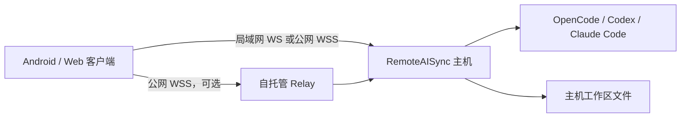

  
  <h1>RemoteAISync</h1>
  
<strong>把自己的 AI 编程 Agent 带到手机和浏览器。</strong>

  
Agent 与项目文件留在你的主机上；你可以通过 Android 或 Web 客户端查看会话、管理工作区，并在需要时接手。

  
  
  
  

**English:** [README.en.md](README.en.md) · **文档导航：** [docs/README.md](docs/README.md)

## 看看 RemoteAISync

| Windows 主机 | 手机客户端 |
| --- | --- |
|  |  |

## 一个主机，按需连接

RemoteAISync 由客户端、Agent 主机和可选的自托管 Relay 组成。Agent 在你的 Windows 或 Linux 主机运行，客户端可在同一局域网直连，也可通过公网 WSS 或自建中继访问。项目不提供模型云服务，也不代理模型供应商账户。

### 支持的 Agent

   <strong>OpenCode</strong>
  &nbsp;&nbsp;&nbsp;
   <strong>Codex</strong>
  &nbsp;&nbsp;&nbsp;
   <strong>Claude Code</strong>

各 Agent 的接入方式和可用操作不同；例如已有 Codex 桌面会话不能被接管其正在运行的轮次。其他边界见[文档导航中的 Agent 说明](docs/README.md)。

## 主要能力

- **远程会话：** 从手机或浏览器查看和继续支持的 Agent 会话，创建会话、发送消息并查看回复与工具活动；可用控制项随 Agent 与会话类型变化。
- **工作区文件：** 浏览主机目录、查看和编辑文本文件、上传附件、下载文件，以及删除选中的文件。
- **安全配对：** 使用主机签发的一次性邀请配对；首次连接由主机批准，已配对设备可查看和撤销。
- **灵活连接：** 局域网直连、公网主机 WSS 直连，或由手机与主机连接自托管 Relay。
- **主机与中继：** Windows 提供桌面管理界面；Ubuntu/Linux 可运行无头主机或 Relay 服务。

## 从这里开始

| 你的目标 | 入口 |
| --- | --- |
| 直接在浏览器体验 | [打开 RemoteAISync Web App](https://ras.xiaoshijourney.com/app/) |
| 从零启动客户端、主机和中继 | [全链路启动指南](docs/全链路启动指南.md) |
| 选择直连或三端中继部署方式 | [两端与三端部署指南](docs/两端与三端部署指南.md) |
| 在 Ubuntu 部署主机或 Relay | [Ubuntu 部署手册（英文）](deploy/ubuntu/README.md) |
| 查找其他说明 | [文档导航](docs/README.md) |

## 安全边界

公网连接使用 WSS；普通 `ws://` 仅用于可信局域网或 VPN。**当前版本不提供端到端加密（E2EE）**：TLS 终止代理以及能够访问 Relay 主机或代理的运营者，可能读取经其转发的应用消息。Relay 负责转发连接，不运行 Agent。请只配对可信设备，并妥善保管主机、中继和设备凭据。

## 项目与贡献

- [项目官网](https://ras.xiaoshijourney.com/) · [Web App](https://ras.xiaoshijourney.com/app/) · [GitHub](https://github.com/xiaoshijourney/RemoteAISync)
- [提交问题或建议](https://github.com/xiaoshijourney/RemoteAISync/issues)
- [MIT License](LICENSE)
