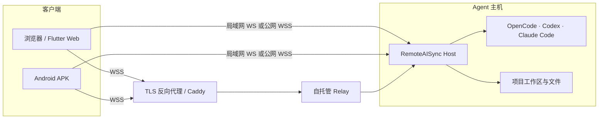
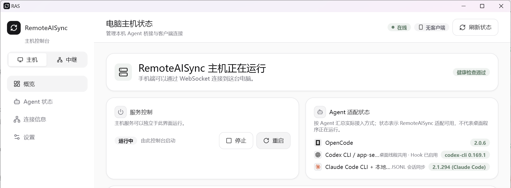
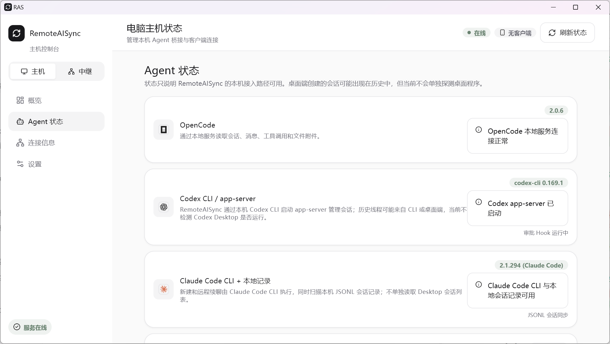
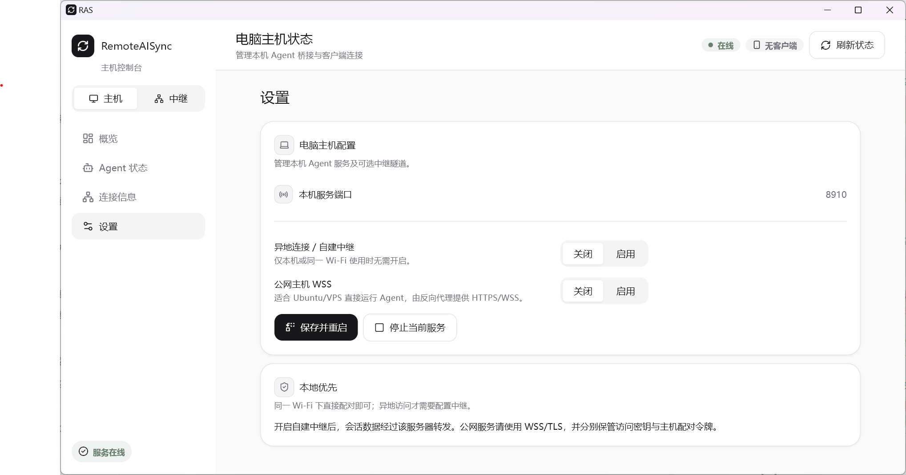
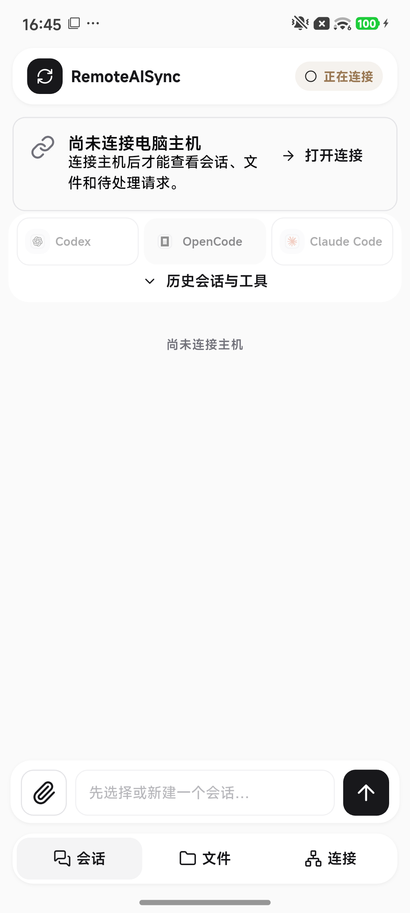
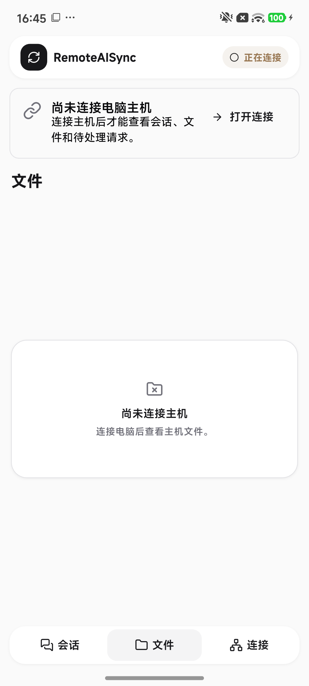

# RemoteAISync（RAS）

**把运行在自己电脑或服务器上的 AI 编程 Agent，安全地带到手机和浏览器。**

RemoteAISync 是一套自托管的远程 Agent 会话客户端、主机服务和 WebSocket 中继。Agent 与项目文件留在主机上运行；手机或浏览器通过局域网直连，或经由你自己部署的中继访问。项目不提供云服务，也不代理模型供应商账户。

[English](README.en.md) · [全链路启动指南](docs/全链路启动指南.md) · [Ubuntu 部署手册](deploy/ubuntu/README.md) · [通信协议](docs/protocol.md) · [问题反馈](https://github.com/xiaoshijourney/RemoteAISync/issues)

## 产品一览

| 客户端 | Agent 主机 | 中继 |
| --- | --- | --- |
| Flutter Web、Android APK | Windows 桌面 GUI；Ubuntu/Linux 无头运行时 | 同一个 Dart 运行时切换为 Relay 模式；Ubuntu 推荐配合 systemd 与 Caddy |



### Windows 主机控制台



### Agent 适配状态



### 主机设置



### 手机会话与文件页

下面的 Android 真机截图展示未连接主机时的会话与文件空状态；连接后，页面会展示主机提供的 Agent、会话和工作区文件。

| 会话 | 文件 |
| --- | --- |
|  |  |

## 能做什么

- 从手机或浏览器查看、继续支持的 OpenCode、Codex 和 Claude Code 会话。
- 创建会话、发送消息、查看 Agent 回复与工具活动，并按 Agent/会话类型使用可用的停止、审批、提问和模型控制。
- 浏览主机工作区、选择工作目录、查看支持的文件、上传附件。
- 扫描主机的一次性配对邀请；首次配对由主机批准，之后可以记住设备并随时撤销。
- 在连接配置中同时保存局域网和中继路线；优先使用可达的局域网路线，异地访问可使用中继或直连 WSS。
- 在同一 Dart 服务运行时中选择 Host 或 Relay 角色。Relay 根据连接与房间凭据转发客户端和主机流量，不运行 Agent。
- 从 Windows GUI 查看 Agent、主机服务、客户端和配对状态；Ubuntu 可通过 systemd 管理无头主机或中继进程。

## Agent 能力与边界

| Agent | 当前接入方式 | 需要知道的限制 |
| --- | --- | --- |
| OpenCode | 主机本地 OpenCode Server API 与事件 | 主机上的 OpenCode 服务必须可用；具体控制项随服务和版本而异。 |
| Codex | 官方 app-server JSON-RPC | RemoteAISync 创建的会话支持实时控制；已有桌面会话主要用于历史查看和排队提交，不能接管桌面端正在运行的轮次或原生待处理问题。 |
| Claude Code | 本地 CLI 与 JSONL 会话记录 | RemoteAISync 启动的任务可继续和停止；Claude 原生 Remote Control 与原生审批交接尚未集成。 |

界面会根据接入能力和会话来源显示操作。Agent 的模型权限、认证、版本和本机 CLI/API 可用性由用户环境决定。

## 选择连接方式

| 场景 | 推荐路线 | 说明 |
| --- | --- | --- |
| 手机和主机在同一 Wi-Fi / 私有 VPN | 局域网直连 `ws://主机IP:8910/ws` | 简单快速；仅用于可信网络。需允许主机防火墙接收连接。 |
| 公网 Ubuntu/VPS 本身运行 Agent | 主机直连 `wss://host.example.com/ws` | 不需要中继；通过 Caddy/Nginx 终止 TLS 并反代到本机 Host 进程。 |
| 家中 Windows 主机位于 NAT 后，需要异地访问 | 手机与主机都连自托管 Relay | 主机主动向外建立中继连接，不需给家用路由器配置入站端口转发。公网使用 WSS。 |
| 私有网络中的中继 | `ws://中继IP:8920/relay` | 仅限可信 LAN/VPN；明文 WS。公网部署必须使用 WSS/TLS。 |

公网 DNS 示例使用 `host.example.com` 和 `relay.example.com`，部署时替换成自己控制的完整域名。域名用于获得常规受信任 TLS 证书；手机端不需手动安装 CA。客户端 Web 页面若要从异地访问，也必须单独部署到可访问的 HTTPS 静态站点；`start_client.bat` 是开发服务器，不是公网托管服务。

## 配对与凭据

1. 主机生成限时、单次配对邀请，并显示二维码或手动信息。
2. 客户端扫描或导入邀请，按配置尝试连接主机。
3. 首次连接由主机操作者批准；获批后客户端保存设备身份，以便重连。
4. 主机可查看和撤销已配对设备。
5. 中继管理员密钥只留在中继端。中继注册码只用于主机注册；手机只使用该主机房间的客户端凭据，不应拿到管理密钥。

不同凭据不能混用：中继管理密钥、一次性主机注册码、房间主机/客户端凭据、手机设备凭据。不要将二维码、令牌、`.env`、私钥或含凭据的截图提交到公开仓库。

## 安全模型

- 公网连接必须使用 `wss://`；`ws://` 仅用于可信局域网或 VPN。
- WSS 在每个端点与 TLS 终止点之间加密。使用反向代理时，代理能看到解密后的应用流量。
- **当前版本没有端到端加密（E2EE）。** 自托管 Relay 的运营者和有权访问 Relay 主机/代理的人可能读取经过转发的应用消息。Relay 不运行 Agent，但不能把它当作对 Relay 不透明的加密隧道。
- Relay 的公开边缘不应开放 `/admin/*`；Dart Host/Relay 监听端口应限制在回环地址或私有网络，并只通过必要的代理路径对公网开放。
- Agent 以主机操作系统用户的权限运行。只授权可信设备，限制可访问的项目目录，并保护主机与中继凭据。

## 快速开始：Windows 开发环境

### 前置条件

- Windows 10/11、Git、Flutter（仓库 Dart SDK 约束为 `^3.12.2`）。
- 构建 Windows 桌面端需要 Visual Studio 的 Desktop development with C++ 工作负载。
- 主机需安装并登录你要使用的 Agent；中继本身不需要安装 Agent。

在 PowerShell 中进入仓库根目录：

```powershell
flutter pub get
flutter run -d windows -t lib/main_desktop.dart
```

在窗口中选择 **主机** 模式，确认 Agent 状态，然后启动主机服务并生成手机配对邀请。不要再从另一个终端启动第二个 `8910` 主机实例。

### 启动 Web 客户端

在第二个终端运行：

```powershell
flutter run -d web-server --web-hostname 0.0.0.0 --web-port 8911
```

- 电脑浏览器：`http://localhost:8911`
- 同一 Wi-Fi 的手机浏览器：`http://<电脑局域网IPv4>:8911`
- 不要把 `0.0.0.0` 当作访问地址。若 Windows 防火墙询问，仅允许 Flutter/Dart 在专用网络通信。

仓库中的 `start_host.bat`、`start_client.bat` 和 `start_relay.bat` 是便捷的开发启动脚本。正式 Windows 便携版可尝试：

```powershell
./tooling/build_windows_release.ps1
```

脚本输出 `build/windows/x64/runner/Release/`，其中包括 Flutter GUI 和 Dart Host/Relay Runtime；这是便携目录，不是安装器。将整个 Release 目录一起分发。

## Android APK

```powershell
flutter pub get
flutter build apk --release
```

APK 路径：`build/app/outputs/flutter-apk/app-release.apk`。USB 调试设备安装：

```powershell
adb install -r build/app/outputs/flutter-apk/app-release.apk
```

Android APK 是客户端；Agent 必须在另一台运行 Host 模式的 Windows/Linux 主机上安装和运行。生产分发前需自行设置 Android 签名配置。

## Ubuntu / Linux 部署

Linux 运行时是同一个可执行文件，通过 `--mode host` 或 `--mode relay` 选择角色。构建需在 Linux 上针对目标架构完成；Windows 产物不能用于 Ubuntu。服务器安装后不需要 Dart SDK。

### 1. 构建

在 Ubuntu 或相同架构 Linux 构建机克隆仓库后：

```bash
chmod +x deploy/ubuntu/build_linux.sh
deploy/ubuntu/build_linux.sh
```

产物为 `build/remotaisync`。将可执行文件安装到 `/opt/remotaisync/remotaisync`。建议先使用仓库内模板部署，详见 [Ubuntu 完整部署手册](deploy/ubuntu/README.md)。

### 2. Ubuntu 作为公网 Agent 主机（无需 Relay）

配置 DNS `host.example.com` 指向服务器，防火墙开放 TCP `80/443`（以及 SSH 管理端口）；不要将 `8910` 直接暴露到公网。安装 Caddy，使用仓库 [Caddyfile](deploy/ubuntu/Caddyfile)，将 `host.example.com` 的 `/ws` 和 `/health` 反代到 `127.0.0.1:8910`。Caddy 可自动申请并续期公网证书。

安装主机服务和环境模板：

```bash
sudo useradd --system --home /var/lib/remotaisync-host --shell /usr/sbin/nologin remotaisync-host
sudo install -d -o remotaisync-host -g remotaisync-host -m 0750 /var/lib/remotaisync-host/project
sudo install -d -o root -g remotaisync-host -m 0750 /etc/remotaisync-host
sudo install -m 0640 -o root -g remotaisync-host deploy/ubuntu/host.env.example /etc/remotaisync-host/host.env
sudo install -m 0644 deploy/ubuntu/remotaisync-host.service /etc/systemd/system/remotaisync-host.service
sudo install -m 0755 build/remotaisync /opt/remotaisync/remotaisync
```

编辑 `/etc/remotaisync-host/host.env`，至少设置项目目录、`wss://host.example.com/ws`、一个随机的 32 字符以上配对令牌和允许的客户端 Web Origin。只有浏览器客户端需要配置 `REMOTEAI_HOST_ALLOWED_ORIGIN`；不要把真实密钥写入仓库。

```bash
sudo systemctl daemon-reload
sudo systemctl enable --now remotaisync-host
sudo systemctl status remotaisync-host
sudo journalctl -u remotaisync-host -f
```

使用 headless 主机时，从服务器本机的 loopback 管理接口创建邀请并批准设备。命令和接口细节见 [Ubuntu 主机部署步骤](deploy/ubuntu/README.md#run-this-ubuntu-server-as-an-agent-host)。

### 3. Ubuntu 作为公网 Relay

配置 `relay.example.com` DNS 指向服务器；仅公开 TCP `80/443`，Relay 内部监听 `127.0.0.1:8920`。Caddy 只反代 `/relay`、`/register-host` 和 `/health`，拒绝公网 `/admin/*`。复制并修改环境模板：

```bash
sudo useradd --system --home /var/lib/remotaisync-relay --shell /usr/sbin/nologin remotaisync
sudo install -d -o root -g root -m 0755 /opt/remotaisync
sudo install -d -o remotaisync -g remotaisync -m 0750 /var/lib/remotaisync-relay
sudo install -d -o root -g remotaisync -m 0750 /etc/remotaisync-relay
sudo install -m 0640 -o root -g remotaisync deploy/ubuntu/relay.env.example /etc/remotaisync-relay/relay.env
sudo install -m 0644 deploy/ubuntu/remotaisync-relay.service /etc/systemd/system/remotaisync-relay.service
sudo install -m 0755 build/remotaisync /opt/remotaisync/remotaisync
```

为 `/etc/remotaisync-relay/relay.env` 设置两个独立随机值：`REMOTEAI_RELAY_ADMIN_TOKEN` 与 `REMOTEAI_RELAY_HOST_SECRET`，各至少 32 字符。保护该文件和 `/var/lib/remotaisync-relay` 中的房间凭据数据，然后启动：

```bash
sudo chown root:remotaisync /etc/remotaisync-relay/relay.env
sudo chmod 0640 /etc/remotaisync-relay/relay.env
sudo systemctl daemon-reload
sudo systemctl enable --now remotaisync-relay
sudo systemctl status remotaisync-relay
sudo systemctl reload caddy
curl --fail https://relay.example.com/health
```

在 Relay 本机签发一次性主机注册码，再由 Windows/Ubuntu 主机 GUI 或配置流程完成注册。注册码只交给主机操作者，不发给手机客户端。完整注册码签发/撤销步骤见 [Ubuntu Relay 部署手册](deploy/ubuntu/README.md#issue-or-revoke-a-host-registration-code)。

### 4. 日常维护

```bash
sudo systemctl restart remotaisync-relay   # 或 remotaisync-host
sudo journalctl -u remotaisync-relay -n 100 --no-pager
curl --fail https://relay.example.com/health
```

主机与中继可以安装在同一 Ubuntu 服务器上，使用独立服务账号、配置、数据目录和端口。备份 Relay 房间状态文件和凭据；轮换密钥时评估已有主机/设备是否需要重新注册或配对。

## Web 客户端部署

构建静态 Web 文件：

```bash
flutter build web --release
```

将 `build/web/` 部署到 HTTPS 静态站点或 Web 服务器。浏览器访问 HTTPS 页面时连接公网主机/中继也必须使用 WSS；跨域部署需在 Host 配置中允许该精确 Origin。不要把开发用的 `flutter run -d web-server` 暴露为生产网站。

## 运行状态与排障

- `8910`：Host WebSocket/HTTP 服务默认端口。
- `8911`：仅 Windows 开发 Web 客户端示例端口。
- `8920`：Relay 本机后端默认端口；公网部署由 TLS 代理接收 `443`。
- `http://0.0.0.0:8911` 不是访问地址；使用 localhost 或电脑真实局域网 IPv4。
- `Address already in use`：同一端口已有进程。停止重复实例，或先检查 GUI 是否已经启动 Host。
- 手机上打不开 Web 开发页：检查手机与电脑是否同一 Wi-Fi、电脑 IPv4 是否正确、Windows 专用网络防火墙和 `8911` 监听状态。
- 连接超时：确认 Host 服务真的运行、配对已批准、端口/反代路径正确，公网连接使用 WSS，并检查 TLS 证书与客户端 Origin。
- 查看更完整的拓扑启动顺序、配置和恢复流程：[全链路启动指南](docs/全链路启动指南.md)。

## 主机画面推流接口规划

当前没有桌面截图、视频推流或远程鼠标控制功能。后续若实现主机画面共享，建议将采集器抽象为独立的 `ScreenCaptureProvider`，提供启动/停止、屏幕与窗口枚举、权限状态、帧尺寸/时间戳和编码帧流；使用 WebRTC（ICE/STUN/TURN）传输实时媒体，控制信令仍走当前已认证的会话链路。平台采集后端分别实现 Windows Graphics Capture 与 Linux PipeWire/门户权限；媒体权限、用户确认、带宽控制和会话授权必须在实现时单独设计。具体预留边界见 [画面推流设计说明](docs/screen-streaming.md)。

## 开发与验证

```powershell
flutter pub get
flutter analyze --no-pub
flutter test --no-pub
flutter build web --release
```

Codex 与真实 Agent 集成测试需要对应 CLI/API 在本机安装、登录，并按测试说明启用。公开部署前请在隔离的测试项目验证网络、配对和权限。

## 项目目录

| 路径 | 内容 |
| --- | --- |
| `lib/` | Flutter Web/Android 客户端与 Windows 控制台 |
| `host/` | Dart Host/Relay 运行时及 Agent 适配器 |
| `deploy/ubuntu/` | Ubuntu systemd、环境模板、Caddy/Nginx 配置 |
| `docs/` | 启动、协议、画面共享规划和文档配图 |
| `tooling/` | Windows 便携版构建脚本 |

## 许可证与贡献

项目采用 [MIT License](LICENSE)。欢迎提交 Issue 和 Pull Request。涉及协议、配对、凭据或传输的修改应附带授权边界和重连行为测试；请勿提交真实凭据、用户项目或含敏感信息的日志/截图。
